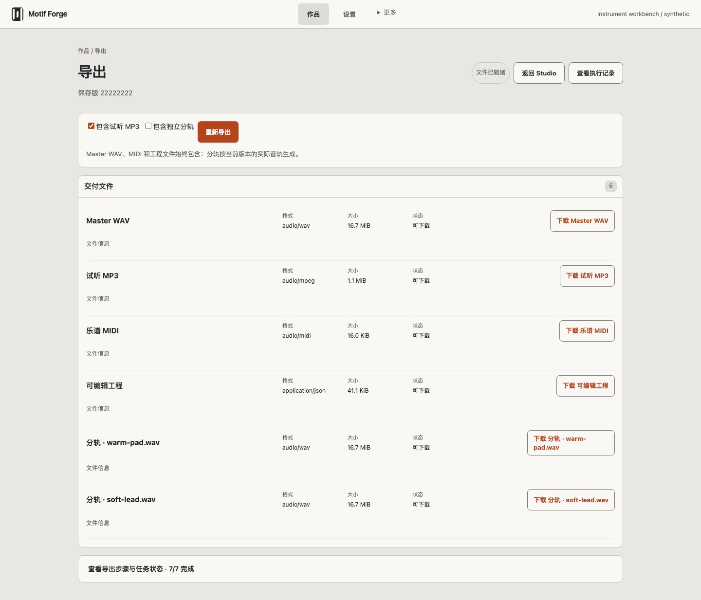

# Motif Forge

[简体中文](README.md) · English

**A local instrumental music workbench for independent creators: review an arrangement plan, compare candidates, then edit and export the version you choose.**

Start with a template that needs no API key, or import existing audio. Plans, human decisions, saved versions, and execution records stay in the same project so you can revise, undo, and investigate failures.

[](docs/IMPLEMENTATION_STATUS.md)
[](LICENSE)

[Demo](#demo) · [Quick start](#quick-start) · [Your first project](#your-first-project) · [Features](#features) · [Configure your API key](#configure-your-api-key) · [Validation and limits](#validation-and-limits) · [Docs and contributing](#docs-and-contributing)

> This is a local, single-user Beta. Templates do not understand arbitrary natural-language requests. Enabling a key does not add whole-song model planning for the default classical and jazz styles. Try the free path first, then use the model features that are actually supported.

## Demo

These show the **implemented instrument-workbench UI from 2026-10-28**: warm-gray surfaces, graphite controls, and burnt-orange accents. They were rendered in a real browser with public synthetic data, mock APIs, and silent media. The export list is sample metadata, not proof of real generation, audio quality, or downloads; the images do not establish that an existing Beta instance has been upgraded. [Asset provenance](docs/images/screenshots-20261028.json).

**Studio: edit and mix one saved version.**


<details>
<summary>Project home and export examples</summary>




</details>

Public audio examples and a real workflow recording are still needed. These are screenshots of the implemented interface, not evidence of musical quality.

## Quick start

### Start a new demo environment

Prepare Node.js **22.12+**, npm, `python3` **3.12–3.13** on PATH, Docker CLI / Compose / Buildx, and `rsync`, then start your Docker daemon. The host and VM must both have access to the data directory; see the environment boundaries below.

No DeepSeek key is required. **For existing projects, read the [runbook](docs/PERSONAL_BETA_RUNBOOK.md) before upgrading**; a new clone must not take ownership of old services.

```bash
git clone https://github.com/Oliveryfaso/Agentic-Music-Studio.git
cd Agentic-Music-Studio
npm ci
scripts/start_motif_forge.sh --no-open
```

When missing, the launcher creates `.env`, initializes the default data root `../.motif-forge-data`, starts this project's backend and frontend, and waits for readiness. Images may be built on first launch. Startup runs the configured database migrations. It does not install or replace Node / Python, or start or stop Colima.

**Success looks like:** `Motif Forge is ready: http://127.0.0.1:5173` in the terminal. Open [http://127.0.0.1:5173](http://127.0.0.1:5173) on the same computer; API readiness is at `http://127.0.0.1:8000/health/ready`. Local addresses do not reach an instance running on another machine.

To stop normally:

```bash
scripts/stop_motif_forge.sh
```

The stopper checks the recorded ownership and retains database volumes, media, images, and containers. It does not operate on other projects. `Ctrl+C` stops only the frontend; use the command above for the backend services too.

A complete fresh-environment installation remains unverified; the [historical S1–S7 checks](docs/evals/S7_EVAL_REPORT.md) do not establish success for every new version and environment.

## Prerequisites

- The verified local runtime is **macOS / Apple Silicon + Colima**. Passing Ubuntu CI does not verify a full installation on other systems.
- Use a dedicated writable data directory accessible to both the host and Docker VM. Initial installation, image pulls, and builds need network access and disk space. There is no measured universal minimum-memory claim.

Read-only diagnostics, without starting services:

```bash
scripts/start_motif_forge.sh --help
scripts/start_motif_forge.sh --check
```

On a fresh clone, `--check` reports missing dependencies, `.env`, or the data root. It is not a step guaranteed to pass before setup. See the [development guide](docs/DEVELOPMENT.md) for installation, ports, and storage troubleshooting.

## Your first project

**Example path: a short background-music sketch → review a template plan and two directions → save an editable version and export it.** This is a usage example, not a generated work or a claim that templates understand arbitrary descriptions. The current UI is primarily in Chinese; labels below identify the relevant controls.

1. On the home page, enter “雨后漫步” under “从想法开始” (start from an idea), then select “创建作品” (create project). This opens “新建编曲” (new arrangement) directly. The top “新建作品” (new project) link jumps to this entry.
2. Keep `Classical Chamber`. Enter “雨后漫步” as the title, “短片背景音乐” for “用途” (purpose), and “平静，温暖” for “情绪” (moods). Set the duration to `60` seconds and leave other settings at their defaults. With no model enabled, select “使用免费模板规划” (plan with the free template).
3. Review the plan and enter the requested reviewer identity and explicit confirmation before approving. Listen to the A/B candidates and choose one. Rule scores are not aesthetic ratings.
4. Edit notes or mix settings in Studio, then save a new version. Playback uses the **rendered saved version**; unsaved drafts do not change the sound immediately.
5. Open export, wait for files to become ready, and download them. Reopen the project to check the saved version. Preview and export should refer to that same saved version.

## Features

| What you want to do | Current implementation |
| --- | --- |
| Review a direction | Brief → structured plan → human approval → two candidates → explicit selection |
| Keep editing | Timeline, Piano Roll, Mixer, drafts, immutable versions, Undo / Redo; supported model edits have scope and approval boundaries |
| Use existing material | WAV / MP3 / FLAC and Stem import, BPM / key confirmation, optional pitch-preserving alignment; originals are retained and rights must be confirmed |
| Export one version | Master WAV, preview MP3, Stems, MIDI, and project files; export plans bind to a saved version and retain completed items after partial failure |
| Inspect tasks and recovery | Persistent progress, decisions, jobs, and usage in Inspector; missing usage stays unknown rather than becoming zero |

Models propose bounded changes. Deterministic code handles musical timing, validation, rendering, and budgets. See the [project guide](docs/PROJECT_GUIDE.md) for the architecture; you do not need to learn it all before trying the app.

## Configure your API key

**This is optional, not a prerequisite for free templates.** Paid whole-song model planning is not implemented for the default classical / jazz styles. Bounded piano editing has limited real-model evidence; it is not general natural-language whole-song creation.

1. Open “设置” (Settings) in the main navigation, or “配置 API Key” in Studio. Obtain your own key from the [official DeepSeek platform](https://platform.deepseek.com/api_keys).
2. In a terminal on the computer running Motif, enter the repository and run the hidden-input command:

   ```bash
   python3 scripts/configure_deepseek.py
   ```

   The default file is `~/.config/motif-forge/deepseek.env`, with directory / file permissions `0700` / `0600`. It is outside the repository; the web page does not receive or display the secret. Saving it **does not activate it**.
3. Finish or cancel current tasks first. These commands apply only to the default demo above; keep the original data / runtime parameters for a personal Beta or custom instance:

   ```bash
   scripts/stop_motif_forge.sh
   scripts/start_motif_forge.sh --enable-deepseek --no-open
   ```

4. Return to Settings, refresh the configuration status, and optionally select “测试连接” (test connection). This makes one authentication request to the official model-list endpoint and generates no work. Success does not verify balance, a particular model, or the Worker path.

Adding a key only to `.env` **does not enable models**. Explicit activation passes the key to the API and resume dispatcher; Docker administrators may read container environments. Model operations send bounded musical structure and descriptions to DeepSeek and may incur charges. Check the running configuration before submitting.

To disable it, stop the same instance normally and restart without the enable flag. `--clear` only removes the local file; it does not clear running processes or revoke the key at the provider. Keep keys out of `VITE_*`, URLs, and logs. See [API key settings](docs/API_KEY_SETTINGS.md) for full steps, pinned-Beta API compatibility, and the clear command. [LangSmith](docs/LANGSMITH.md) is off by default and requires separate configuration.

## Validation and limits

- **Default sounds and real piano are separate profiles.** The default uses lightweight synthesized sounds, not a complete sample library. New projects offer Classical Chamber and Jazz Harmony & Improvisation; historical electronic styles retain compatibility for existing works.
- **Reviewed material is limited.** There are four fixed melody excerpts of 8–16 bars and 26 samples in the pinned 2019 piano pack, not a complete music library. [Reviewed data preparation](docs/REVIEWED_DATA_PREPARATION.md) requires the legitimate source archive and a compatible tool; it does not download or install them automatically.
- **Evidence has limits.** A small real-piano model-edit / save / Undo / same-version export loop has [recorded evidence](docs/evidence/2026-10-22-beta-real-model-loop.md). It does not establish arbitrary duration, scores, styles, or subjective quality. The [historical Eval](docs/evals/S7_EVAL_REPORT.md) reports internal cases, not a music-quality pass rate.
- **Some gates remain open.** A complete fresh installation through the first work, the current real-key end-to-end path, post-restore application playback / export, and pinned-image cold rebuild are not all verified. The storage / execution isolation candidate also awaits full integration validation. Isolated PostgreSQL / media recovery is not full application recovery.
- **Product scope.** This is a local, single-user instrumental workbench. Desktop is intended for detailed editing; mobile focuses on review, playback, and approval. A professional DAW, collaboration, public hosting, and automatic vocal separation are outside the completed scope.

<details>
<summary>Existing reviewed-piano Beta: how it differs from the default demo</summary>

It requires reviewed sounds, host / VM sharing, and matching pinned local images. It is not a one-command installation from a new clone. The repository's [release-pin template](scripts/personal-beta-release.v1.json) neither identifies every machine's running version nor supplies its images.

Reuse the existing data root and runtime receipt. Updating source or the web page alone does not update that instance's API, images, or pin. Check the [personal Beta runbook](docs/PERSONAL_BETA_RUNBOOK.md) and [implementation status](docs/IMPLEMENTATION_STATUS.md); an undeployed candidate is not a live release.

</details>

## Docs and contributing

Frontend changes can use host-side checks without rebuilding Docker:

```bash
npm ci
npm run test:web
npm run build:web
npm run test:audio
```

[CI](.github/workflows/ci.yml) runs no-key Python, Web / audio regression and builds for main / Pull Requests. It does not start a real database or call a model. Tests requiring real external services are conditionally skipped; green CI is not full-installation, musical-quality, or recovery acceptance.

| Document | Purpose |
| --- | --- |
| [Development and troubleshooting](docs/DEVELOPMENT.md) | Backend setup, tests, ports, screenshots, and common issues |
| [API key settings](docs/API_KEY_SETTINGS.md) | Hidden input, explicit activation, status checks, and removal |
| [Reviewed data preparation](docs/REVIEWED_DATA_PREPARATION.md) | Pinned archive, tool compatibility, and preparation boundaries |
| [Personal Beta runbook](docs/PERSONAL_BETA_RUNBOOK.md) | Existing instances, resources, pinned images, and maintenance |
| [Isolated recovery tools](docs/ISOLATED_RECOVERY.md) | Default dry-run, trusted archives, and recovery limits |
| [Implementation status](docs/IMPLEMENTATION_STATUS.md) / [Roadmap](docs/NEXT_DEVELOPMENT_ROADMAP.md) | Deployed, candidate, and unverified work |
| [Project guide](docs/PROJECT_GUIDE.md) / [Decisions](docs/DECISION_LOG.md) | Product and architecture contracts |

The linked technical documents are currently primarily in Chinese. For issues, include the profile, version, reproduction steps, and sanitized error codes, not keys or private audio. Source lives in `apps/web`, `services/api`, `services/render-worker`, and `packages/audio-engine`.

## License

Project code uses the [Apache License 2.0](LICENSE). Sound packs, imports, and third-party components have their own licenses; the code license does not grant rights to every asset.

```text
Copyright 2026 Oliver

Licensed under the Apache License, Version 2.0 (the "License");
you may not use this file except in compliance with the License.
You may obtain a copy of the License at

    http://www.apache.org/licenses/LICENSE-2.0
```

Keep [LICENSE](LICENSE) when redistributing, and mark source changes as required by section 4.
