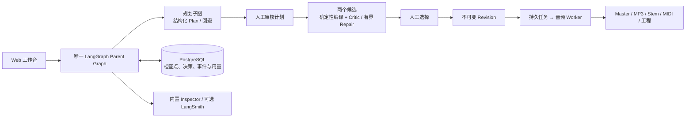

# Motif Forge

**面向独立音乐创作者与 Agent 应用开发者的本地音乐工作台：审核编曲计划、比较试听候选，把选中的结果继续编辑并导出。**

从一个想法开始，也可以导入已有音频。计划、人工选择、保存版本和执行记录留在同一个工程中，方便继续修改、撤销和查看失败原因。

[](docs/IMPLEMENTATION_STATUS.md)
[](LICENSE)

[演示](#演示) · [快速开始](#快速开始) · [第一次试用](#第一次试用) · [核心能力](#核心能力) · [配置与限制](#配置与限制) · [开发与贡献](#开发与贡献)

> 当前面向本机单用户试用。默认启动不调用付费模型；真实钢琴个人 Beta 是另一个需要预置审核资源和固定镜像的运行档位，不能把开发分支或隔离候选自动视为已部署版本。

## 演示

旧版绿色界面截图已移除。当前源码使用明亮底色与蓝紫强调色；最新真实截图、操作录屏和可公开作品试听仍待补齐，不使用概念图冒充产品界面。界面验证方法见[开发指南](docs/DEVELOPMENT.md#界面验证与截图)。

## 快速开始

开始前准备 Node.js 22.12+、npm、Python 3.12–3.13、已启动的 Docker / Compose / Buildx，以及宿主和 VM 都能访问的可写数据目录。完整前提见下方运行环境；已有作品请沿用原环境，不用新 clone 认领旧服务。

下面先体验无 Key 路径；S1–S7 历史验证见 [Eval 报告](docs/evals/S7_EVAL_REPORT.md)，不代表所有新版本与环境都已验收。

### 从源码体验默认演示

这是默认的合成音色 / 确定性回退路径，不要求 DeepSeek Key。

```bash
git clone https://github.com/Oliveryfaso/Agentic-Music-Studio.git
cd Agentic-Music-Studio
git switch codex/motif-p0-piano-preparation
npm ci
scripts/start_motif_forge.sh --no-open
```

这里选择现有开发分支；`main`、开发分支和本机固定镜像 Beta 的版本可能不同。请先核对所读 README 与检出的版本一致。

启动器会在缺少时从 `.env.example` 创建本地 `.env`，初始化默认数据根 `../.motif-forge-data`，启动本项目的 Compose 服务、等待 API 与渲染器就绪，再启动前端。首次可能构建镜像；启动会执行当前源码对应的数据库迁移，因此请仅对新演示环境运行，已有环境升级先看[运行手册](docs/PERSONAL_BETA_RUNBOOK.md)。

**成功标志：** 终端显示 `Motif Forge is ready: http://127.0.0.1:5173`。在运行服务的同一台电脑打开 [http://127.0.0.1:5173](http://127.0.0.1:5173)，应看到作品首页；API 就绪地址是 `http://127.0.0.1:8000/health/ready`。`localhost` 链接不提供远程电脑访问。

正常结束：

```bash
scripts/stop_motif_forge.sh
```

停止器按本启动器记录核对 Web 和容器所有权，保留数据卷、媒体、镜像和容器，不启停 Colima、不操作其他项目。仅按启动终端的 `Ctrl+C` 会停止前端，后台服务仍需上述停止命令。

只查看帮助或检查条件：

```bash
scripts/start_motif_forge.sh --help  # 无需启动服务
scripts/start_motif_forge.sh --check # 不启动服务；首次尚无 .env / 数据根时会报告缺失
```

端口、外置盘或 Docker 不可用时，先处理报出的具体条件，见[开发与排障](docs/DEVELOPMENT.md)。不要反复创建新 runtime 目录认领旧服务。

## Prerequisites · 运行前准备

- **已验证环境：** macOS / Apple Silicon + Colima。需要先自行启动可用的 Docker daemon；其他操作系统及 Docker Desktop 路径尚需验证。
- **工具：** Node.js 22.12+、npm、Python 3.12–3.13、Docker CLI / Compose / Buildx，以及构建脚本使用的 `rsync`。仅修改后端时另需 uv。
- **存储与网络：** 准备可写的专用数据目录，确保宿主与 Docker VM 都能访问。首次安装依赖、拉取基础镜像与构建需要网络和磁盘空间；这里没有经过测量的通用最低内存承诺。
- **已有作品：** 继续使用原仓库、原数据根和原 runtime 所有权记录。不要用一个新 clone 自动接管既有服务，也不要删除数据库卷来解决启动问题。

## 第一次试用

以一个短背景音乐草案为例：**只有“安静、缓慢”的想法 → 审核结构与配器、比较两个方向 → 保存一个能继续编辑、导出并追溯来源的版本。** 这是操作示例，不是对默认回退理解任意自然语言的承诺。

1. 在首页输入作品名并创建作品，点击「新建编曲」。
2. 在 Brief 保留 `Classical Chamber`，标题填「雨后漫步」，用途填「安静的短片背景音乐」，情绪填「平静，温暖」，时长填 `60` 秒，其余约束先留默认，再点「提交 Brief 并规划」。
3. 阅读 Plan 的段落和轨道安排；填写审批身份与明确确认说明后批准生成。
4. 分别试听 A/B 候选，查看规则评估，再明确选择其中一个。默认无 Key 时页面应标记确定性回退，规则分也不等于音乐审美评分。
5. 打开 Studio，修改音符或混音参数后保存新版本。试听器播放**已渲染的保存版本**，未保存草稿不会即时改变声音。
6. 打开导出页，等待文件就绪后下载；重新打开作品检查保存版本。运行检查页可查看任务、人工决定和模型用量。

先走通这个无模型例子，再考虑启用外部模型或真实钢琴档位。导入自己的 WAV / MP3 / FLAC 或 Stem 时，需要确认素材权利并审核分析结果。

## 核心能力

| 你要做的事 | 当前实现 |
| --- | --- |
| 审核创作方向 | Brief → 结构化 Plan → 人工审批 → 两个候选 → 明确选择；不会把未批准候选当正式版本 |
| 继续修改作品 | Timeline、Piano Roll、Mixer、草稿保存与不可变 Revision；有界 AI 选区编辑，高影响修改先试听确认 |
| 管理已有素材 | 音频 / Stem 导入、BPM / 调性确认、可选择的保持音高时间对齐；原始导入保留 |
| 带走同一保存版本 | Master WAV、试听 MP3、Stem、MIDI 与工程文件；动态导出计划绑定具体 Revision，部分失败保留已完成项 |
| 查看执行事实 | Graph Inspector 展示持久事件、决策、任务与用量；恢复概览与截断时间线分开，缺失用量不会显示成零 |

模型提出有界结构，确定性代码负责音乐时序、校验、事务、渲染与预算。一个版本化 LangGraph Parent Graph 承接生成、导入、编辑与导出，PostgreSQL 保存工程事实和恢复状态；Redis/Celery 分发任务。详细合同见[项目指南](docs/PROJECT_GUIDE.md)。

<details>
<summary>创作主路径示意</summary>



这张图只说明主创作的数据流，不表示额外的生产 Graph，也不代表全部异常分支。

</details>

## 配置与限制

### 默认演示与真实钢琴 Beta

| 档位 | 能做什么 | 首跑边界 |
| --- | --- | --- |
| 默认源码演示 | 新建古典 / 爵士策略、轻量内置合成音色，体验计划 / 候选 / 编辑 / 导出 | 上面的首跑路径；Style Pack 表达编曲策略，不代表真实乐器采样库 |
| 审核曲库双钢琴个人 Beta | 固定审核主旋律摘录、真实钢琴资源、局部伴奏与修订 | 需合法审核包、宿主与 VM 共享、既有固定镜像；不是全新 clone 后一条命令可安装的成品 |
| 隔离工程候选 | 发布、备份和执行隔离方面的后续修复 | 离线或单独边界通过不等于已经上线；以当前实施状态逐项为准 |

新建入口提供 Classical Chamber、Jazz Harmony & Improvisation，默认古典；历史 Synth Ambient、Minimal Electronic 的 ID、旧作品与导出保留，不再是新建选择。默认音源使用 12 个语义别名映射到 3 个合成核心与 click sample；真实钢琴档位另走固定资源校验。

当前审核资料仅有四个 8–16 小节的固定主旋律摘录，不是完整曲库。固定 2019 钢琴包的 26 个样本在开发环境已有验证，但仓库尚缺从对应上游归档复原 manifest 的公开准备入口，不能用新版包替代固定 pin。UI fixture 的静音 PCM 仅用于界面测试，不作真实试听或音质证据。

个人 Beta 当前 API 发布 pin 为 [`a3bfb1a`](scripts/personal-beta-release.v1.json)，兼容数据库 `20261020_0030`。`--personal-beta` 的启动器验证固定本地 API 镜像和 schema；普通 `--personal-beta api` 构建产生的 `:local` 镜像不能自动满足此 pin。缺镜像或审核资源会明确失败，不下载音源、不改 pin、不启动 / 重启 VM。安装、构建与当前验证边界请先读[个人 Beta 运行手册](docs/PERSONAL_BETA_RUNBOOK.md)。

已完成配置的同一 Beta 环境，才使用：

```bash
scripts/start_motif_forge.sh --personal-beta --check
scripts/start_motif_forge.sh --personal-beta --no-open
# 本档位默认 Web：http://127.0.0.1:15173
scripts/stop_motif_forge.sh --personal-beta
```

媒体根可用 `MOTIF_FORGE_BETA_STORAGE_ROOT`、已有审核包可用 `MOTIF_FORGE_REVIEWED_PIANO_ROOT` 指定；`DOCKER_CONTEXT` 可显式选择 daemon，不改变全局 context。沿用原 `MOTIF_FORGE_RUNTIME_DIR` 回执。数据盘不可用时不静默回落其他磁盘；模型仍默认禁用。

### 外部服务与费用

- **默认不调用付费模型。** Compose 显式清空 `DEEPSEEK_API_KEY`；仅在 `.env` 填 Key 不会启用它。无 Key 规划使用确定性回退；旧通用 AI Edit 回退只支持明确的 gain / 本地音色意图，不能当完整自然语言编辑。
- **当前配置入口的限制：** 本分支尚无供首次用户直接保存、验证和清除 Key 的日常设置页。已有显式开发验证流程不等于开箱即用的配置体验；在该入口补齐前，请先试用无 Key 路径，不将 Key 写入浏览器变量或为了启用模型直接删除 Compose 保护。
- **真实模型是显式开发流程。** 钢琴局部编辑已有少量官方 DeepSeek 实测，包含多轮保存、Undo 与同版本导出；这不代表任意请求或全风格已通过。外部调用会按服务定价计费并发送有界音乐结构与指令，运行前需检查身份、预算、数据范围与停止条件。入口见[开发验证](docs/DEVELOPMENT.md#真实服务与验收)及[实施状态](docs/IMPLEMENTATION_STATUS.md)。
- **LangSmith 可选。** 默认关闭；开启会使用外部追踪服务，应先核对记录范围与费用，见 [LangSmith 配置](docs/LANGSMITH.md)。Key 不放进前端 `VITE_*`、日志或仓库。

### 已验证范围

- 同一真实钢琴 Beta 项目的两轮模型局部编辑、保存、Undo、重新读取与同版本完整导出已有[实测证据](docs/evidence/2026-10-22-beta-real-model-loop.md)；小样本不能外推全曲、任意长曲、任意曲谱或所有风格。
- 历史 S7 Eval 是 **96 条内部 inventory：80 实测通过、13 预期拒绝、3 未测**，不是 96 首作品的音质通过率。见 [Eval 报告](docs/evals/S7_EVAL_REPORT.md)。
- 固定镜像冷重建和当前真实作品的独立恢复仍未完成整体验证；归档完整性不是恢复成功。后续存储/执行隔离候选未随本分支发布，不能将其离线检查写成当前运行版本的验收。
- 桌面浏览器适合精细编辑；移动端侧重查看、试听与审批。专业 DAW、多人协作、公开托管、自动人声分离与规模化主观音质评估不在当前完成声明中。
- 新 clone 首跑与既有 Beta 运行证据是不同边界；历史证据和当前缺口见[实施状态](docs/IMPLEMENTATION_STATUS.md)。

## 开发与贡献

前端先使用已有依赖锁，不必为界面修改重建 Docker：

```bash
npm ci
npm run test:web
npm run build:web
npm run test:audio
```

后端宿主环境与 PostgreSQL 集成测试按[开发指南](docs/DEVELOPMENT.md)配置；涉及数据库的测试只能指向专用测试库。提交问题或改动时，请提供运行档位、可复现步骤、预期 / 实际结果及已脱敏错误码，不附 Key 或私人音频。

| 文档 | 内容 |
| --- | --- |
| [开发与排障](docs/DEVELOPMENT.md) | 安装、测试、截图复现与常见问题 |
| [个人 Beta 运行手册](docs/PERSONAL_BETA_RUNBOOK.md) | 档位、固定资源、日常使用与维护边界 |
| [实施状态](docs/IMPLEMENTATION_STATUS.md) / [后续路线](docs/NEXT_DEVELOPMENT_ROADMAP.md) | 已部署、候选与未验事项 |
| [项目指南](docs/PROJECT_GUIDE.md) / [决策记录](docs/DECISION_LOG.md) | 产品、架构与规则依据 |
| [技术演进](docs/TECH_EVOLUTION.md) / [前端规范](docs/FRONTEND_UX_SPEC.md) | 历史证据与交互合同 |

源码主要位于 `apps/web`、`services/api`、`services/render-worker` 和 `packages/audio-engine`。音源、导入素材和第三方组件的许可分别核对，不能把项目代码许可当作所有素材的使用授权。

## 许可证

本项目采用 [Apache License 2.0](LICENSE) 授权，允许商用、修改与再分发，并附带专利授权条款。

```
Copyright 2026 Oliver

Licensed under the Apache License, Version 2.0 (the "License");
you may not use this file except in compliance with the License.
You may obtain a copy of the License at

    http://www.apache.org/licenses/LICENSE-2.0
```

再分发时请保留 [LICENSE](LICENSE) 文件；如修改了源文件，需按第 4 条标注改动。
